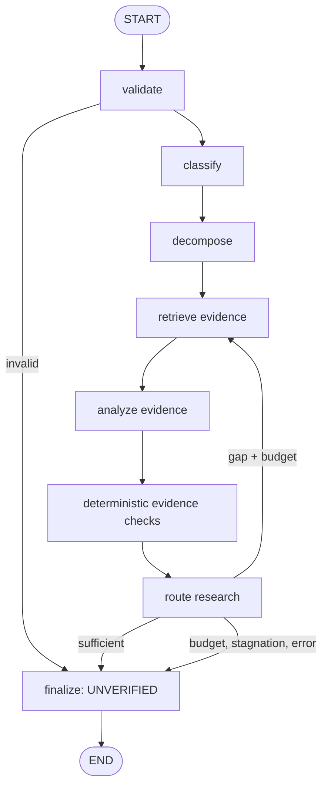

# KajiAI-LangGraph

The frozen DeepSeek comparison resumed from the 80-cell checkpoint. The interim artifacts cover 47 reused and 33 fresh cells. See the [current handoff](CONTINUATION.md). [Interim PDF](evaluation/paper.pdf), [editable manuscript](evaluation/paper.tex), [source archive](evaluation/paper-source.zip), [evaluation report](artifacts/aris/run_20261106_deepseek500/REPORT.md), [verification](artifacts/aris/run_20261106_deepseek500/VERIFICATION.md), and [reproducibility archive](artifacts/aris/run_20261106_deepseek500/deepseek500-reproducibility.zip).

Historical research: [completed 500-by-two Gemma study](evaluation/results/study-20261009-v3/RESULTS.md), [working manuscript](evaluation/paper.tex), and [November 2 offline audit](evaluation/aris/20261102_120247/RESEARCH_AUDIT.md). The authoritative frozen runtime and dataset remain archived with that study. Current scores measure development-set label agreement; independent citation annotation remains unfinished.

Standalone Python/LangGraph implementation of KajiAI's evidence-driven
claim-analysis workflow. It does not import from or execute the CrewAI reference
project.

The workflow classifies and decomposes a claim, retrieves external evidence,
audits supporting/conflicting/missing evidence, verifies quotation provenance,
and repeats targeted research while bounded by round, search, token, and time
budgets. A model proposes a verdict; verification checks decide whether to accept it.
The output separates an evidence-based **prediction** from its **verification
status**. A rejected prediction remains available for evaluation; the legacy
`verdict` field remains `UNVERIFIED` when the acceptance gate fails. Execution
errors are reported separately from insufficient evidence.

## Architecture



The typed graph state carries the original claim, domain, assertions, complete
retrieval ledger, research rounds, assessment, gaps, contradictions, budgets,
stop reason, verdict, and final report. Each retrieved record retains its URL,
snippet/full-page text, UTC timestamp, SHA-256 content hash, originating query,
provider, and lineage identifier. Similar text across hosts is flagged as
possible copied lineage and cannot satisfy the acceptance gate.

### Decomposition into statements and questions

The default `statements` method keeps deterministic statement splitting. The
optional `statements_and_questions` method asks the configured Ollama model for
1-6 self-contained statements and 1-8 neutral verification questions. It preserves
dates, quantities, attribution and causal scope, and asks questions that can find
both supporting evidence and counterevidence. These are research leads; their
contents are not established facts.

```bash
uv run --env-file .env kaji-langgraph "Claim to investigate" \
  --decomposition-method statements_and_questions --format json
```

For an offline wiring check, use `--mock` with the same option. The mock backend
uses deterministic question templates rather than a cloud model.

For Python callers, set
`config["model"]["decomposition_method"] = "statements_and_questions"` before
calling `run_claim`. JSON output retains `assertions`, `verification_questions`
and `decomposition_method`; the report also lists generated questions. Actual
queries remain separately recorded in `search_queries` and each research round.

Unused verification questions are searched before generic claim queries;
targeted follow-ups from an evidence assessment take priority. Existing search,
round, time and token budgets still apply. Questions do not become additional
acceptance requirements or count as evidence. The original claim and all generated
statements still require resolution through the unchanged gate. The optional
method uses a structured model request and may use the adapter's existing single
schema-repair request. Failed or malformed plans fall back to statement splitting,
record an error and mark token accounting incomplete; output then reports
`decomposition_method: statements_fallback`.

This mode is an engineering addition, not a validated study improvement. Historical
study manifests and source archives remain frozen; any live comparison using this
mode needs a new source/settings freeze and its own development diagnostic.

Retrieval failures use policy-controlled bounded retries with linear backoff;
the deadline is checked before every attempt and before sleeping. Retries do
not consume additional logical search calls. Scientific, political, medical,
and general runs inject separate research, analysis, and verification guidance
from configuration into the model prompt.

Acceptance requires all of the following:

- proposed verdict is `TRUE`, `FALSE`, `MISLEADING`, or `CONFLICTING` with High confidence;
- every assertion is resolved and cites retrieved evidence;
- every finding has citations and each citation has an exact quote found in its
  retrieved text;
- at least two source hosts are cited without duplicate lineage among the cited sources;
- counterevidence was searched and the assessment establishes independence;
- no unresolved gaps or contradictions remain;
- domain-specific HTTPS or peer-review requirements pass.

Quotation matching verifies provenance only. It does not prove entailment,
credibility, or truth.
Immediately before accepting a decisive verdict, finalization independently
reruns the structural gate and checks Jev's citation review when enabled. A
changed or stale intermediate state therefore fails closed with
`final_gate_rejected`.

## Install and run

Requirements: Python 3.10–3.13, [`uv`](https://docs.astral.sh/uv/), Ollama, and a TinyFish API key. A TypeSafe key enables Jev review.

```bash
uv sync --extra dev
ollama signin
ollama pull gemma4:31b-cloud
export TINYFISH_API_KEY="your-api-key"
export TYPESAFE_API_KEY="your-typesafe-key"
uv run --env-file .env kaji-langgraph "Claim to investigate" --domain auto --format report
```

Ollama must be running. The defaults match the reference project:

```text
model: gemma4:31b-cloud
endpoint: http://localhost:11434
```

Override them without editing source:

```bash
export KAJI_MODEL=gemma4:31b-cloud
export KAJI_OLLAMA_BASE_URL=http://localhost:11434
export KAJI_TIMEZONE=Asia/Jakarta
```

Live retrieval uses [TinyFish Search](https://docs.tinyfish.ai/search-api/reference)
for ranked URLs and [TinyFish Fetch](https://docs.tinyfish.ai/fetch-api/reference)
for clean page text. Set `TINYFISH_API_KEY` in the environment; the key is never
stored in the project. The graph counts search calls and full-page attempts
against its configured budgets. Fetch failures are recorded in the retrieval
audit and search snippets remain available.

For local `.env` files, use `uv run --env-file .env kaji-langgraph ...`.
The `.env` file is ignored by Git. `uv run` does not load it by default.

The CLI streams each graph step, search, page fetch, and Jev/Ollama check to
stderr as it happens. The completed report or JSON goes to stdout, so JSON
remains pipeable. Pass `--no-progress` to hide progress. These are operation
traces; a heartbeat appears every 15 seconds during slow calls. Structured
model responses still arrive when each model call finishes.

The current generous limits are 10 research rounds, 20 searches, 20 page
fetches, 30 minutes, and 250,000 aggregate reported tokens. They are ceilings:
research can finish earlier when the evidence is sufficient or stops improving.
The limits are configured in `src/kaji_langgraph/config/default.yaml`; larger
limits can increase TinyFish, TypeSafe, and Ollama usage and runtime.

If you run this checkout from both Windows and WSL, keep separate virtual
environments. Windows can use the default `.venv`. In WSL, run
`UV_PROJECT_ENVIRONMENT=.venv-wsl uv run --env-file .env kaji-langgraph ...`.
Sharing one `.venv` can leave Unix symlinks that Windows `uv` cannot remove.

When `TYPESAFE_API_KEY` is available, the official TypeSafe Python SDK runs
four Jev judgments in the graph:

- select the claim domain; uncertain selections fall back to Ollama;
- rank search results so the limited full-page fetches target more promising URLs;
- review retrieved sources for relevance, counterevidence, and instructions aimed
  at the assistant; clearly irrelevant or suspicious sources cannot support a verdict;
- compare cited findings with the quote and surrounding source text; unsupported,
  contradictory, or uncertain citations create research gaps. A citation check
  failure returns an auditable `UNVERIFIED` result.

The model and thresholds are in `config/default.yaml`. Jev's judgments and source
scores appear in JSON output under `jev_audit` and `retrieval_ledger`. These are
probabilistic judgments, so evaluate the thresholds against representative claims
before treating accepted verdicts as reliable. `--mock` stays fully offline.

No Anthropic or OpenAI key is used. If Ollama is unavailable, the workflow does
not switch providers: classification/decomposition may use deterministic
fallbacks, but analysis fails closed to an auditable `UNVERIFIED` report.

For a fully offline deterministic smoke run:

```bash
uv run kaji-langgraph "The deterministic fixture claim is documented" --mock --format report
```

Run tests:

```bash
uv run pytest
```

## Output and limitations

`--format` accepts `report`, `brief`, or `json`. JSON includes the full retrieval
ledger, source lineage, queries, timing, budgets, research history, and errors.
The system is a research assistant, not a truth oracle. Search snippets may be
incomplete; source independence and semantic entailment still require human
review even when deterministic structural checks pass.

## Evaluate on AVeriTeC

Start Ollama before live inference (`ollama serve`, or open the Ollama app).
An unavailable model is an execution failure, not a factual verdict.

```bash
# Offline dataset audit, including the class-imbalance baseline
uv run python -m kaji_langgraph.evaluation inspect --output evaluation/results/dataset-audit.json

# Seeded 10-claim live pilot (uses the configured services)
uv run --env-file .env python -m kaji_langgraph.evaluation run --limit 10 --seed 42 --output evaluation/results/pilot

# Continue an interrupted run with exactly the same options and code
uv run --env-file .env python -m kaji_langgraph.evaluation run --limit 10 --seed 42 --output evaluation/results/pilot --resume
```

Each run saves a manifest, per-claim JSONL traces, a CSV, metrics with confusion
matrices, and a readable Markdown report. The runner defaults to three rounds
and a 300-second scheduling budget per claim; in-flight service calls may finish
after that budget. It stops on an execution error by default. `--limit 500` runs
the full provided dev split; this can consume substantial service usage.
`--ids 0,6,9,10` selects explicit zero-based dataset rows for diagnosis.

Predictions support the four AVeriTeC classes. `NOT_ENOUGH_EVIDENCE` is a model
assessment of insufficiency; it is not inferred from an API failure or rejected
citation. `CONFLICTING` requires evidence on both sides to pass verification.
The older, broader `MISLEADING` class is retained for compatibility but is not
silently mapped to the narrower AVeriTeC conflict class.

Live inference receives only claim text and claim date. Gold labels,
justifications, annotated answers, and fact-check URLs are withheld. Search
can still find published fact checks: this is a contemporary open-web experiment,
not a historical evidence-cutoff benchmark. These are **label-only metrics**,
not the official AVeriTeC evidence score. See [evaluation/README.md](evaluation/README.md)
for the research protocol, ablations, interpretation, and limitations.

The following are historical runner examples for the paired study. The original
output directory is preserved; these examples are not instructions to rerun it.
A new approved condition must use a new directory:

```bash
uv run --env-file .env python -m kaji_langgraph.study --limit 500 --workers 3 --seed 20261009 --max-rounds 3 --max-seconds 300 --output evaluation/results/NEW-APPROVED-STUDY
# Resume with exactly the same options plus --resume.
uv run python -m kaji_langgraph.study_analysis evaluation/results/NEW-APPROVED-STUDY
```

The study saves a source snapshot, dataset snapshot, per-round unfiltered
assessments, exact source-version keys, and structural versus semantic gaps.
Final analysis includes confidence intervals, paired accuracy differences,
first-round truncation, and offline acceptance-policy replay. These replays
reuse saved evidence and are not independent live workflow ablations. A blinded
citation-audit worksheet is generated with human judgments left blank.
